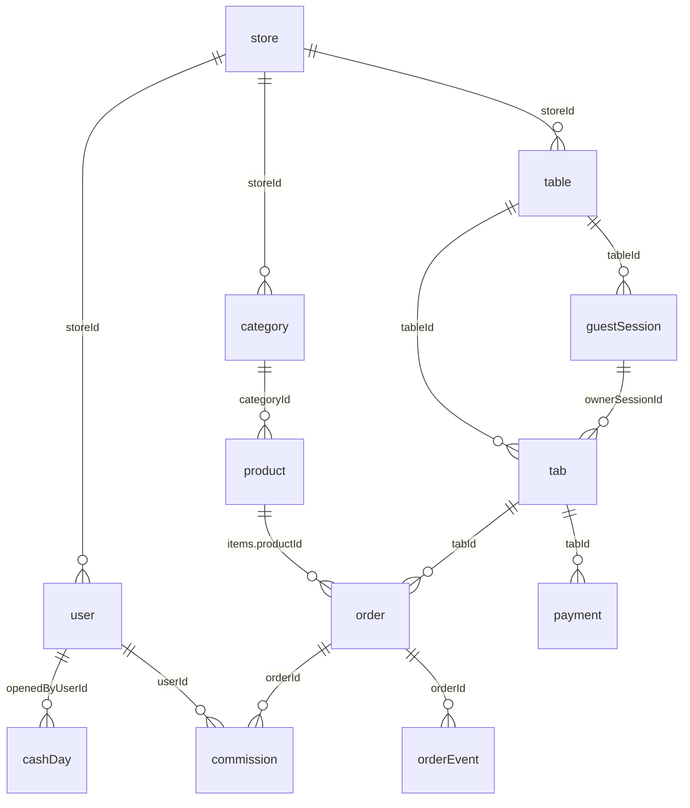

# Dicionário de dados

Banco **MongoDB 7**, database `pedeai`. As coleções, a validação de cada uma (`$jsonSchema`) e os índices são criados pelo script [`banco/init-mongo.js`](../banco/init-mongo.js); a casa de demonstração é carregada por [`banco/seed.js`](../banco/seed.js). Só o `backend/` lê e grava no banco.

Levantado em 23/11/2026 a partir do `banco/init-mongo.js`, do código do backend e dos documentos gravados pela aplicação.

## Convenções

- **Multiempresa:** toda coleção, menos `store` e `sequence`, tem `storeId`, e toda consulta filtra por ele. É o que impede uma casa de ver os dados de outra.
- **Identificadores** de coleções e campos em inglês; valores de enumeração em maiúsculas (`OPEN`, `PREPARING`).
- **Referências** entre coleções são `ObjectId` com sufixo `Id` (`tabId`, `productId`).
- **Dinheiro em centavos**, sempre inteiro: `3200` é R$ 32,00. Percentuais em pontos-base: `1000` é 10%.
- **Datas** gravadas em UTC; a tela converte para o fuso da casa (America/Sao_Paulo).
- **Cópia no pedido:** o item do pedido guarda nome e preço do momento do envio (`nameSnapshot`, `unitPriceCents`). Mudar o cardápio não altera pedido já feito.
- **Validação `moderate`:** o MongoDB recusa documentos novos fora do esquema, mas aceita campos extras. Os campos que a aplicação grava e o script não declara estão marcados como **(fora do validador)**.
- **(reservado):** campo previsto no esquema e ainda não usado pela aplicação nesta versão.

Tipos: `ObjectId`, `String`, `Int` (inteiro de 32 bits), `Double`, `Bool`, `Date`, `Objeto` (subdocumento) e `Array`.

## Visão geral

| Coleção | O que guarda |
| --- | --- |
| `store` | A casa (cliente do whitelabel): marca, horários, taxas e regras |
| `user` | Pessoas da equipe da casa, com perfil de acesso |
| `table` | Mesas do salão e o token do QR code de cada uma |
| `category` | Categorias do cardápio |
| `product` | Produtos do cardápio, com preço, disponibilidade e opções |
| `guestSession` | Sessão do cliente que entrou pelo QR ou pelo balcão |
| `tab` | Comanda: conta de uma pessoa (ou grupo) na mesa ou no balcão |
| `order` | Pedido enviado de uma comanda, com os itens |
| `orderEvent` | Histórico de eventos de cada pedido |
| `payment` | Pagamentos registrados |
| `commission` | Comissão dos garçons por pedido |
| `cashDay` | Abertura e fechamento do caixa do dia |
| `sequence` | Contadores diários (número do pedido, senha de retirada) |
| `tableChange` | Junção e troca de mesas **(reservado)** |
| `waitlist` | Fila de espera **(fora do MVP)** |

## Relacionamentos



Todas as coleções da figura também têm `storeId` apontando para `store`; a figura mostra só as ligações principais.

## Coleções

### `store`

A casa. Tudo que é whitelabel mora aqui.

| Campo | Tipo | Obrig. | Descrição |
| --- | --- | --- | --- |
| `_id` | ObjectId | sim | Identificador da casa |
| `slug` | String | sim | Nome curto na URL (`triunfo-lanches`); 3 a 40 caracteres `a-z`, `0-9` e `-`; único |
| `name` | String | sim | Nome da casa |
| `kind` | String | não | Tipo: `BAR`, `RESTAURANTE`, `LANCHONETE`, `CAFETERIA` |
| `document` | String | não | CNPJ ou CPF |
| `phone` | String | não | Telefone da casa |
| `address` | Objeto | não | Endereço: `street`, `number`, `district`, `city`, `state`, `zip` (todos String) |
| `logoUrl` | String | não | Endereço do logotipo |
| `primaryColor` | String | sim | Cor da casa no app do cliente, no formato `#RRGGBB` |
| `tagline` | String | não | Frase de apresentação na capa |
| `pixKey` | String | não | Chave Pix usada para gerar o Pix copia e cola; sem ela o app não oferece Pix |
| `openingHours` | Array de Objeto | não | Um item por dia da semana (ver abaixo) |
| `openingHours[].weekday` | Int | sim | Dia da semana, 0 (domingo) a 6 |
| `openingHours[].opensAt` | String | sim | Abertura, `HH:mm` |
| `openingHours[].closesAt` | String | sim | Fechamento, `HH:mm` |
| `openingHours[].lastOrderAt` | String | não | Último horário de pedido, `HH:mm` |
| `serviceModes` | Array de String | não | Modos oferecidos ao cliente: `TABLE` (mesa), `COUNTER` (balcão), `DELIVERY` (reservado) |
| `serviceFeeBasisPoints` | Int | sim | Taxa de serviço da mesa em pontos-base, 0 a 3000 (`1000` = 10%) |
| `commissionBasisPoints` | Int | sim | Comissão do garçom em pontos-base, 0 a 3000 (`500` = 5%) |
| `requireCustomerPhone` | Bool | não | Se a casa exige o celular do cliente na entrada |
| `allowRepeatRound` | Bool | não | Liga o botão "Mais uma rodada" na comanda |
| `pausedUntil` | Date | não | Pedidos pausados até esse momento |
| `pausedScopes` | Array de String | não | O que está pausado: `KITCHEN`, `DRINKS`, `COUNTER` |
| `isTraining` | Bool | sim | Casa de treino: não entra nos relatórios |
| `active` | Bool | sim | Casa ativa |
| `createdAt` | Date | sim | Criação |
| `updatedAt` | Date | não | Última alteração |

### `user`

Pessoa da equipe de uma casa.

| Campo | Tipo | Obrig. | Descrição |
| --- | --- | --- | --- |
| `_id` | ObjectId | sim | Identificador |
| `storeId` | ObjectId | sim | Casa |
| `name` | String | sim | Nome |
| `email` | String | sim | E-mail de login; único dentro da casa |
| `passwordHash` | String | sim | Senha cifrada com BCrypt (nunca a senha em texto) |
| `role` | String | sim | Perfil: `OWNER` (dono), `MANAGER` (gerente), `WAITER` (garçom), `KITCHEN` (cozinha) |
| `active` | Bool | sim | Usuário ativo; desativado não entra |
| `mustChangePassword` | Bool | não | Obriga a trocar a senha no próximo acesso |
| `failedAttempts` | Int | não | Tentativas de login erradas seguidas |
| `lockedUntil` | Date | não | Login bloqueado até esse momento |
| `lastLoginAt` | Date | não | Último login |
| `createdAt` | Date | sim | Criação |
| `updatedAt` | Date | não | Última alteração |

### `table`

Mesa do salão.

| Campo | Tipo | Obrig. | Descrição |
| --- | --- | --- | --- |
| `_id` | ObjectId | sim | Identificador |
| `storeId` | ObjectId | sim | Casa |
| `number` | Int | sim | Número da mesa (≥ 1); único dentro da casa |
| `nickname` | String | não | Apelido ou área (ex.: "Varanda") |
| `seats` | Int | não | Lugares |
| `token` | String | sim | Código que vai no QR da mesa; único. Gerar outro invalida a plaquinha antiga |
| `active` | Bool | sim | Mesa em uso |
| `createdAt` | Date | sim | Criação |

### `category`

Categoria do cardápio.

| Campo | Tipo | Obrig. | Descrição |
| --- | --- | --- | --- |
| `_id` | ObjectId | sim | Identificador |
| `storeId` | ObjectId | sim | Casa |
| `name` | String | sim | Nome (ex.: "Lanches") |
| `position` | Int | sim | Ordem no cardápio (≥ 0) |
| `visible` | Bool | sim | Aparece para o cliente |

### `product`

Produto do cardápio.

| Campo | Tipo | Obrig. | Descrição |
| --- | --- | --- | --- |
| `_id` | ObjectId | sim | Identificador |
| `storeId` | ObjectId | sim | Casa |
| `categoryId` | ObjectId | sim | Categoria (`category._id`) |
| `name` | String | sim | Nome |
| `description` | String | não | Descrição, até 140 caracteres |
| `priceCents` | Int | sim | Preço em centavos (≥ 1) |
| `imageUrl` | String | não | Foto |
| `prepMinutes` | Int | não | Tempo médio de preparo, em minutos |
| `available` | Bool | sim | Disponível; a casa desliga quando o item acaba |
| `unavailableSince` | Date | não | Desde quando está indisponível |
| `isAlcoholic` | Bool | não | Bebida alcoólica: exige a confirmação de 18 anos no pedido |
| `position` | Int | sim | Ordem dentro da categoria |
| `optionGroups` | Array de Objeto | não | Grupos de opções (ponto da carne, adicionais) |
| `optionGroups[].name` | String | sim | Nome do grupo |
| `optionGroups[].required` | Bool | sim | Escolha obrigatória |
| `optionGroups[].min` / `max` | Int | sim | Mínimo e máximo de opções escolhidas |
| `optionGroups[].options` | Array de Objeto | sim | Opções do grupo |
| `optionGroups[].options[].label` | String | sim | Nome da opção |
| `optionGroups[].options[].deltaCents` | Int | sim | Quanto a opção soma ao preço, em centavos |

### `guestSession`

Sessão do cliente, criada quando ele informa nome (e celular) pelo QR da mesa ou pelo balcão. O cliente não tem conta nem senha: recebe um token (JWT) de convidado ligado a esta sessão.

| Campo | Tipo | Obrig. | Descrição |
| --- | --- | --- | --- |
| `_id` | ObjectId | sim | Identificador; vai dentro do token do cliente |
| `storeId` | ObjectId | sim | Casa |
| `tableId` | ObjectId | não | Mesa; ausente no balcão |
| `mode` | String | sim | `TABLE`, `COUNTER` ou `DELIVERY` (reservado) |
| `name` | String | não | Nome que o cliente digitou |
| `phone` | String | não | Celular só com dígitos (DDD + 9 + 8 dígitos) |
| `a11yPrefs` | Objeto | não | Preferências de acessibilidade: `scale` (Double), `highContrast` (Bool) **(reservado)** |
| `consent` | Objeto | não | Consentimento (LGPD): `notify` (aceita avisos), `history` (aceita guardar histórico), `at` (Date) |
| `createdAt` | Date | sim | Criação |
| `expiresAt` | Date | sim | Validade, 4 horas depois da criação; um índice TTL apaga a sessão vencida sozinho |

### `tab`

Comanda. A comanda é por pessoa, não por mesa: uma mesa pode ter várias comandas, e quem abre é o dono. Outras pessoas da mesa entram com o código de convite. A comanda de balcão é uma comanda sem mesa.

| Campo | Tipo | Obrig. | Descrição |
| --- | --- | --- | --- |
| `_id` | ObjectId | sim | Identificador |
| `storeId` | ObjectId | sim | Casa |
| `tableId` | ObjectId | não | Mesa; ausente no balcão |
| `mode` | String | sim | `TABLE`, `COUNTER` ou `DELIVERY` (reservado) |
| `customerName` | String | não | Nome do dono da comanda |
| `ownerSessionId` | ObjectId | sim | Sessão de quem abriu (`guestSession._id`); só o dono convida, remove e paga por Pix |
| `managedBy` | String | sim | Quem controla a comanda: `CUSTOMER` ou `STAFF` |
| `managedByUserId` | ObjectId | não | Funcionário responsável, quando `STAFF` **(reservado)** |
| `joinCode` | String | não | Código de convite de 4 dígitos |
| `joinCodeExpiresAt` | Date | não | Validade do código (5 minutos; é trocado quando vence) |
| `participants` | Array de Objeto | não | Pessoas que entraram com o código |
| `participants[].sessionId` | ObjectId | sim | Sessão do participante |
| `participants[].name` | String | sim | Nome |
| `participants[].joinedAt` | Date | sim | Entrada |
| `participants[].removedAt` | Date | não | Removido pelo dono; os itens dele continuam na conta |
| `status` | String | sim | `OPEN` (aberta), `AWAITING_PAYMENT` (esperando pagamento), `CLOSED` (fechada) |
| `pickupTicket` | Int | não | Senha de retirada do dia, só no balcão (vem de `sequence`) |
| `subtotalCents` | Int | não | Consumo, sem taxa |
| `serviceFeeCents` | Int | não | Taxa de serviço (mesa; zero no balcão) |
| `discountCents` | Int | não | Desconto |
| `discountReason` | String | não | Motivo do desconto: `DELAY`, `WRONG_ORDER`, `REGULAR`, `OWNER` **(reservado)** |
| `discountByUserId` | ObjectId | não | Quem deu o desconto **(reservado)** |
| `totalCents` | Int | não | Total a pagar |
| `paidCents` | Int | não | Quanto já foi pago |
| `splitMode` | String | não | Divisão: `SINGLE`, `EQUAL`, `BY_CONSUMPTION` |
| `mergedWithBillId` | ObjectId | não | Comanda com que foi juntada **(reservado)** |
| `openedAt` | Date | sim | Abertura |
| `closedAt` | Date | não | Fechamento |
| `closedByUserId` | ObjectId | não | Quem fechou |
| `reopenedAt` / `reopenReason` | Date / String | não | Reabertura **(reservado)** |
| `waiterCalls` | Array de Objeto | não | Chamados de garçom feitos pela comanda **(fora do validador)** |
| `waiterCalls[].id` | String | — | Identificador do chamado |
| `waiterCalls[].type` | String | — | Motivo: `CLOSE_BILL`, `QUESTION`, `MISSING_ITEM`, `PIX_SENT`, `ORDER_PROBLEM` |
| `waiterCalls[].reason` | String | — | Texto do motivo para a tela do salão |
| `waiterCalls[].status` | String | — | `OPEN` ou `RESOLVED`; não abre dois chamados abertos do mesmo tipo |
| `waiterCalls[].bySessionId` | ObjectId | — | Sessão de quem chamou |
| `waiterCalls[].createdAt` | Date | — | Quando chamou |
| `waiterCalls[].resolvedAt` / `resolvedBy` | Date / ObjectId | — | Quando e quem atendeu |

### `order`

Pedido enviado de uma comanda. Antes de gravar, o backend confere o pedido com o servidor de validação (`server/`, comando `VALIDATE_ORDER`).

| Campo | Tipo | Obrig. | Descrição |
| --- | --- | --- | --- |
| `_id` | ObjectId | sim | Identificador |
| `storeId` | ObjectId | sim | Casa |
| `tabId` | ObjectId | sim | Comanda (`tab._id`) |
| `tableId` | ObjectId | não | Mesa; ausente no balcão |
| `number` | Int | sim | Número do pedido no dia (vem de `sequence`) |
| `status` | String | sim | `AWAITING_PAYMENT` (balcão, esperando pagar), `RECEIVED`, `PREPARING`, `READY`, `DELIVERED`, `CANCELLED` |
| `pickupTicket` | Int | não | Cópia da senha de retirada, no balcão |
| `ageConfirmed` | Bool | não | Cliente confirmou 18 anos (pedido com bebida alcoólica) |
| `items` | Array de Objeto | sim | Itens do pedido (pelo menos um) |
| `items[].productId` | ObjectId | sim | Produto |
| `items[].nameSnapshot` | String | sim | Nome do produto no momento do envio |
| `items[].unitPriceCents` | Int | sim | Preço unitário no envio, já com as opções |
| `items[].basePriceCents` | Int | não | Preço do produto sem as opções |
| `items[].quantity` | Int | sim | Quantidade (≥ 1; a validação limita a 20) |
| `items[].note` | String | não | Observação do cliente, até 140 caracteres |
| `items[].options` | Array de Objeto | não | Opções escolhidas: `group`, `label`, `deltaCents` |
| `items[].status` | String | sim | Mesmos status do pedido, mais `REMOVED` |
| `items[].placedByType` | String | sim | Quem lançou: `CUSTOMER`, `PARTICIPANT` ou `STAFF` |
| `items[].placedBySessionId` | ObjectId | não | Sessão do cliente que pediu; a conta usa para separar o consumo por pessoa |
| `items[].placedByUserId` | ObjectId | não | Funcionário que lançou |
| `items[].deliveredAt` | Date | não | Entrega do item (entregas parciais) |
| `items[].removedAt` / `removedByUserId` | Date / ObjectId | não | Remoção do item |
| `totalCents` | Int | sim | Total do pedido |
| `cancelReason` | String | não | Motivo do cancelamento: `GAVE_UP`, `WRONG_ORDER`, `OUT_OF_STOCK`, `DUPLICATE` |
| `cancelledByUserId` / `cancelledAt` / `cancelNote` | ObjectId / Date / String | não | Quem cancelou, quando e observação |
| `createdAt` | Date | sim | Envio |
| `readyAt` | Date | não | Ficou pronto |
| `deliveredAt` | Date | não | Entregue |
| `paidAt` | Date | não | Pago no caixa (balcão) **(fora do validador)** |
| `updatedAt` | Date | não | Última alteração **(fora do validador)** |
| `statusHistory` | Array de Objeto | não | Mudanças de status: `from`, `to`, `byUserId`, `at`; o cliente vê como linha do tempo **(fora do validador)** |

### `orderEvent`

Registro de tudo que acontece com um pedido.

| Campo | Tipo | Obrig. | Descrição |
| --- | --- | --- | --- |
| `_id` | ObjectId | sim | Identificador |
| `storeId` | ObjectId | sim | Casa |
| `orderId` | ObjectId | sim | Pedido |
| `type` | String | sim | `CREATED`, `STATUS_CHANGED`, `CANCELLED`, `ITEMS_DELIVERED`; `ITEM_REMOVED` e `PRINTED` (reservados) |
| `from` / `to` | String | não | Status antes e depois |
| `byUserId` | ObjectId | não | Quem fez |
| `note` | String | não | Observação |
| `reason` | String | não | Motivo do cancelamento (mesmos valores de `order.cancelReason`) |
| `itemIndexes` | Array de Int | não | Itens entregues, na entrega parcial |
| `at` | Date | sim | Quando |

### `payment`

Pagamento registrado pela equipe. A confirmação automática de Pix ficou fora do escopo: o pagamento é registrado à mão.

| Campo | Tipo | Obrig. | Descrição |
| --- | --- | --- | --- |
| `_id` | ObjectId | sim | Identificador |
| `storeId` | ObjectId | sim | Casa |
| `tabId` | ObjectId | sim | Comanda paga |
| `orderId` | ObjectId | não | Pedido pago no caixa, no balcão **(fora do validador)** |
| `method` | String | sim | `PIX_MANUAL`, `CASH` (dinheiro), `CARD_DEBIT`, `CARD_CREDIT` |
| `amountCents` | Int | sim | Valor (≥ 1) |
| `payerName` | String | não | Quem pagou |
| `isPartial` | Bool | sim | Pagamento parcial (ex.: um pedido de balcão) |
| `registeredByUserId` | ObjectId | não | Funcionário que registrou |
| `createdAt` | Date | sim | Registro |

### `commission`

Comissão do garçom, calculada no fechamento.

| Campo | Tipo | Obrig. | Descrição |
| --- | --- | --- | --- |
| `_id` | ObjectId | sim | Identificador |
| `storeId` | ObjectId | sim | Casa |
| `userId` | ObjectId | sim | Garçom |
| `tabId` | ObjectId | sim | Comanda |
| `orderId` | ObjectId | sim | Pedido |
| `baseCents` | Int | sim | Valor sobre o qual a comissão é calculada |
| `rateBasisPoints` | Int | sim | Percentual em pontos-base (copiado de `store.commissionBasisPoints`) |
| `amountCents` | Int | sim | Valor da comissão |
| `status` | String | sim | `PENDING`, `CONFIRMED`, `REVERSED`, `PAID` |
| `createdAt` | Date | sim | Criação |
| `confirmedAt` | Date | não | Confirmação |
| `reversedAt` | Date | não | Estorno **(reservado)** |
| `paidAt` | Date | não | Pagamento ao garçom **(fora do validador)** |

### `cashDay`

Caixa do dia.

| Campo | Tipo | Obrig. | Descrição |
| --- | --- | --- | --- |
| `_id` | ObjectId | sim | Identificador |
| `storeId` | ObjectId | sim | Casa |
| `openedByUserId` | ObjectId | sim | Quem abriu |
| `openingFloatCents` | Int | sim | Troco inicial |
| `openedAt` | Date | sim | Abertura |
| `closedAt` / `closedByUserId` | Date / ObjectId | não | Fechamento e quem fechou |
| `countedCents` | Objeto | não | Valor contado por forma: `CASH`, `PIX_MANUAL`, `CARD_DEBIT`, `CARD_CREDIT` (Int) |
| `differenceCents` | Int | não | Diferença entre o contado e o esperado |
| `differenceNote` | String | não | Justificativa da diferença |
| `withdrawals` | Array de Objeto | não | Sangrias: `reason`, `amountCents`, `at`, `byUserId` |

### `sequence`

Contadores do dia, incrementados de forma atômica (`findAndModify` com `$inc`), para que dois pedidos ao mesmo tempo nunca peguem o mesmo número.

| Campo | Tipo | Obrig. | Descrição |
| --- | --- | --- | --- |
| `_id` | String | sim | `<storeId>:<AAAA-MM-DD>:<tipo>`, com tipo `ORDER` (número do pedido) ou `PICKUP` (senha de retirada) |
| `seq` | Int | sim | Último número usado |

### `tableChange` (reservado)

Junção (`MERGE`) e troca (`MOVE`) de mesas. A coleção é criada, mas a aplicação ainda não grava nela.

| Campo | Tipo | Obrig. | Descrição |
| --- | --- | --- | --- |
| `storeId` | ObjectId | sim | Casa |
| `kind` | String | sim | `MERGE` ou `MOVE` |
| `fromTableId` / `toTableId` | ObjectId | sim | Mesa de origem e de destino |
| `byUserId` | ObjectId | sim | Quem fez |
| `at` | Date | sim | Quando |

### `waitlist` (fora do MVP)

Fila de espera da casa.

| Campo | Tipo | Obrig. | Descrição |
| --- | --- | --- | --- |
| `storeId` | ObjectId | sim | Casa |
| `name` | String | sim | Nome de quem espera |
| `phone` | String | não | Celular |
| `partySize` | Int | sim | Quantas pessoas |
| `number` | Int | sim | Número na fila |
| `status` | String | sim | `WAITING`, `CALLED`, `SEATED`, `GAVE_UP` |
| `createdAt` | Date | sim | Entrada na fila |
| `calledAt` | Date | não | Chamado **(reservado)** |

## Índices

| Coleção | Campos | Tipo | Para quê |
| --- | --- | --- | --- |
| `store` | `slug` | único | Achar a casa pela URL |
| `user` | `storeId`, `email` | único | Login; e-mail não se repete na casa |
| `user` | `storeId`, `role` | — | Listar a equipe por perfil |
| `table` | `storeId`, `number` | único | Número de mesa não se repete na casa |
| `table` | `token` | único | Achar a mesa pelo QR |
| `category` | `storeId`, `position` | — | Cardápio em ordem |
| `product` | `storeId`, `categoryId`, `position` | — | Produtos da categoria em ordem |
| `product` | `storeId`, `available` | — | Só os disponíveis |
| `guestSession` | `expiresAt` | TTL | Apaga a sessão vencida |
| `guestSession` | `storeId`, `tableId` | — | Sessões da mesa |
| `tab` | `storeId`, `status`, `openedAt` | — | Comandas abertas, mais novas primeiro |
| `tab` | `storeId`, `tableId`, `status` | — | Comandas abertas da mesa |
| `tab` | `storeId`, `closedAt` | — | Histórico de contas fechadas |
| `tab` | `joinCode`, `joinCodeExpiresAt` | — | Entrar pelo código de convite |
| `order` | `storeId`, `status`, `createdAt` | — | Fila da cozinha em ordem de chegada |
| `order` | `storeId`, `tabId`, `createdAt` | — | Pedidos da comanda (conta, rodada) |
| `order` | `storeId`, `number`, `createdAt` | — | Achar o pedido pelo número |
| `payment` | `storeId`, `tabId` | — | Pagamentos da comanda |
| `commission` | `storeId`, `userId`, `status`, `createdAt` | — | Comissões de cada garçom |
| `commission` | `orderId` | — | Comissão do pedido |
| `cashDay` | `storeId`, `openedAt` | — | Caixa do dia |
| `orderEvent` | `orderId`, `at` | — | Histórico do pedido em ordem |
| `tableChange` | `storeId`, `at` | — | Histórico de mudanças de mesa |
| `waitlist` | `storeId`, `status`, `number` | — | Fila em ordem |

## Como criar o banco

```bash
mongosh "<string de conexao>" banco/init-mongo.js   # coleções, validação e índices
mongosh "<string de conexao>" banco/seed.js         # casa de demonstração triunfo-lanches
```

Com Docker, o serviço `db-init` do `docker-compose.yml` roda os dois scripts na primeira subida.
