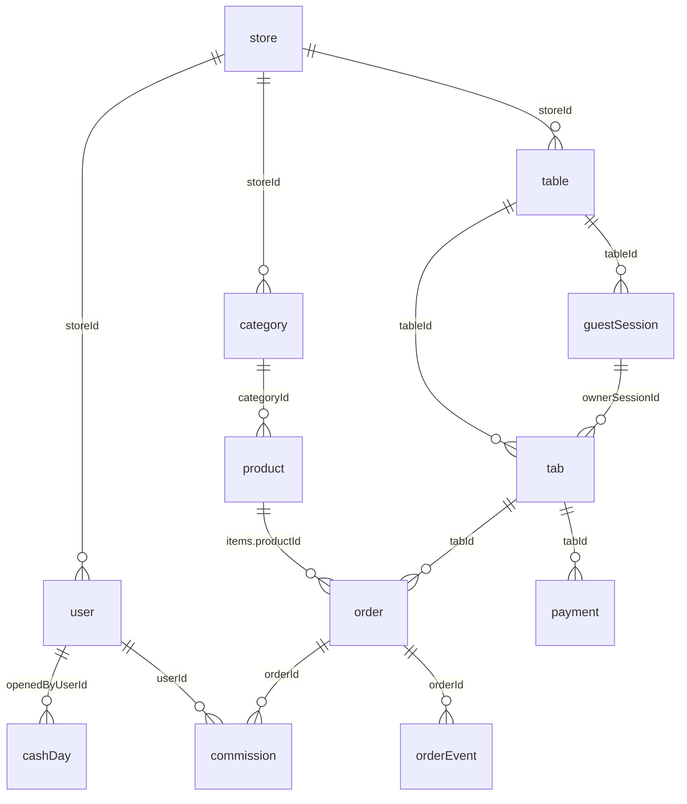

# Dicionário de Dados: Pede Aí, comanda digital whitelabel para bares, restaurantes e cafeterias

> Documento técnico do banco de dados do Pede Aí (Projeto Integrador IV, Engenharia de Software, PUC-Campinas). Define as coleções, os campos, os tipos especiais, o desdobramento físico no MongoDB, as regras de gravação e a estratégia de versionamento do esquema. A fonte da verdade é o script [`banco/init-mongo.js`](../banco/init-mongo.js) (validadores `$jsonSchema` e índices); a casa de demonstração é carregada por [`banco/seed.js`](../banco/seed.js). Só o `backend/` lê e grava no banco.

## 1. Histórico de versões (ou revisões)

| Data | Autor | Versão | Comentários |
| :---: | :--- | :---: | :--- |
| 23/11/2026 | Mateus Souza Marinho | 1.1.0 | **Reorganização no modelo de dicionário do projeto**, mantendo os dados levantados na versão 1.0.0. (1) Tabelas de campos com as colunas Tipo conceitual, Obrigatório, Característica, Ex. aceitos, Ex. não aceitos e Comentários. (2) Novas seções: tipos especiais (C/M/MC), desdobramento físico (documentos embutidos × referências), consultas e índices, estratégia de versionamento, regras de gravação, pendências e observações finais. (3) Marcações **(reservado)** e **(fora do validador)** levadas para a coluna Característica. |
| 23/11/2026 | Bruno Terra Silverio | 1.0.0 | **Dicionário reescrito a partir do banco atual** (`banco/init-mongo.js`, código do backend e documentos gravados pela aplicação). Substitui o antigo `docs/modelo.md`, que descrevia um modelo anterior (`tenant`, `bill`, `orderItem`, `counter`). Marca os campos que a aplicação grava e o validador não declara **(fora do validador)** e os campos previstos e ainda não usados **(reservado)**. |

> **Nota de migração de modelo:** o `docs/modelo.md` original previa conta (`bill`) separada da comanda, itens do pedido numa coleção própria (`orderItem`) e um contador (`counter`). O modelo implementado é orientado a documentos: a comanda (`tab`) faz o papel de conta, os itens ficam **embutidos** no pedido (`order.items`) e os contadores diários ficam em `sequence`.

## 2. Entidades e atributos conceituais

Convenções desta seção:
- **Tipos conceituais:** Identificador (`ObjectId`), Texto (`String`), Número inteiro (`Int`, 32 bits), Número decimal (`Double`), Booleano (`Bool`), Data e hora (`Date`), subdocumento e lista (ver seção 3).
- **Dinheiro** é sempre inteiro em centavos (`3200` = R$ 32,00); **percentuais** em pontos-base (`1000` = 10%).
- **Característica "Cópia":** o valor é copiado de outra coleção no momento da gravação e não muda depois.
- **(reservado):** campo previsto no esquema e ainda não usado pela aplicação nesta versão.
- **(fora do validador):** a aplicação grava, mas o `init-mongo.js` não declara. O validador `moderate` aceita campos extras.

### 2.1. Casa (`store`)

O estabelecimento que usa o sistema (o cliente do whitelabel). Tudo que é whitelabel mora aqui: nome, slug, cor, horários, taxas e regras. É a raiz do multiempresa.

| Atributo / Dado | Tipo conceitual | Obrigatório | Característica | Ex. aceitos | Ex. não aceitos | Comentários |
| :--- | :---: | :---: | :---: | :--- | :--- | :--- |
| _id | Identificador | Sim | Simples | `ObjectId` | Vazio ou duplicado | É o `storeId` das demais coleções. |
| slug | Texto | Sim | Simples, **único** | `triunfo-lanches` | `Triunfo Lanches`; `ab`; acentos | Nome curto na URL (`/t/<slug>`): 3 a 40 caracteres `a-z`, `0-9` e `-`. |
| name | Texto | Sim | Simples | Triunfo Lanches | Vazio | Nome da casa. |
| kind | Texto / enum | Não | Domínio fechado | `BAR`; `RESTAURANTE`; `LANCHONETE`; `CAFETERIA` | `PIZZARIA` | Tipo da casa. |
| document | Texto | Não | Simples | CNPJ ou CPF | — | Documento da casa. |
| phone | Texto | Não | Simples | `(19) 3333-0000` | — | Telefone da casa. |
| address | Endereço | Não | Composto (C) | ver 3.1 | — | Endereço da casa. |
| logoUrl | Texto / URL | Não | Simples | `https://.../logo.png` | URL inválida | Logotipo no cardápio e no painel. |
| primaryColor | Texto | Sim | Simples | `#C62828` | `vermelho`; `#FFF` | Cor da casa no app do cliente, formato `#RRGGBB`. |
| tagline | Texto | Não | Simples | Lanches desde 1998 | — | Frase de apresentação na capa. |
| pixKey | Texto | Não | Simples | Chave Pix | — | Usada para gerar o Pix copia e cola; sem ela o app não oferece Pix. |
| openingHours | Horário | Não | Multivalorado e composto (MC) | ver 3.2 | — | Um item por dia da semana. |
| serviceModes | Lista de enum | Não | Multivalorado (M) | `["TABLE","COUNTER"]` | `["MESA"]` | Modos oferecidos ao cliente: `TABLE` (mesa), `COUNTER` (balcão), `DELIVERY` (reservado). |
| serviceFeeBasisPoints | Número inteiro | Sim | Simples | `1000` (10%) | `-1`; `5000` | Taxa de serviço da mesa, de 0 a 3000. Não se aplica ao balcão. |
| commissionBasisPoints | Número inteiro | Sim | Simples | `500` (5%) | `-1`; `5000` | Comissão do garçom, de 0 a 3000. |
| requireCustomerPhone | Booleano | Não | Simples | `true`; `false` | — | Se a casa exige o celular do cliente na entrada. |
| allowRepeatRound | Booleano | Não | Simples | `true`; `false` | — | Liga o botão "Mais uma rodada" na comanda. Ausente vale `true`. |
| pausedUntil | Data e hora | Não | Simples | `2026-11-23T21:15:00Z` | — | Pedidos pausados até esse momento. |
| pausedScopes | Lista de enum | Não | Multivalorado (M) | `["KITCHEN"]` | `["BAR"]` | O que está pausado: `KITCHEN`, `DRINKS`, `COUNTER`. |
| isTraining | Booleano | Sim | Simples | `true`; `false` | — | Casa de treino: não entra nos relatórios. |
| active | Booleano | Sim | Simples | `true`; `false` | — | Casa inativa não abre cardápio nem login. |
| createdAt | Data e hora | Sim | Simples | Data UTC | — | Criação. |
| updatedAt | Data e hora | Não | Simples | Data UTC | — | Última alteração. |

### 2.2. Usuário da equipe (`user`)

Pessoa da equipe de uma casa, com perfil de acesso. O cliente final **não** é usuário: entra como sessão de convidado (ver 2.6).

| Atributo / Dado | Tipo conceitual | Obrigatório | Característica | Ex. aceitos | Ex. não aceitos | Comentários |
| :--- | :---: | :---: | :---: | :--- | :--- | :--- |
| _id | Identificador | Sim | Simples | `ObjectId` | — | Identificador. |
| storeId | Identificador | Sim | Simples | Casa existente | — | Casa do usuário. |
| name | Texto | Sim | Simples | Zé | Vazio | Nome. |
| email | Texto | Sim | Simples, **único na casa** | `ze@triunfolanches.com` | `ze@`; repetido na mesma casa | E-mail de login, junto com o slug da casa. |
| passwordHash | Texto | Sim | Simples | Hash BCrypt | Senha em texto | Senha cifrada com BCrypt; a senha em texto nunca é gravada. |
| role | Texto / enum | Sim | Domínio fechado | `OWNER`; `MANAGER`; `WAITER`; `KITCHEN` | `ADMIN` | Dono, gerente, garçom e cozinha. Decide o que a pessoa vê e pode fazer. |
| active | Booleano | Sim | Simples | `true`; `false` | — | Usuário desativado não entra. |
| mustChangePassword | Booleano | Não | Simples | `true` | — | Obriga a trocar a senha no próximo acesso. |
| failedAttempts | Número inteiro | Não | Simples | `0` a `3` | Negativo | Tentativas de login erradas seguidas. Na 3ª, a conta é bloqueada. |
| lockedUntil | Data e hora | Não | Simples | Agora + 15 min | — | Login bloqueado até esse momento (15 minutos). |
| lastLoginAt | Data e hora | Não | Simples | Data UTC | — | Último login. |
| createdAt | Data e hora | Sim | Simples | Data UTC | — | Criação. |
| updatedAt | Data e hora | Não | Simples | Data UTC | — | Última alteração. |

### 2.3. Mesa (`table`)

Mesa do salão, com o token que vai no QR code.

| Atributo / Dado | Tipo conceitual | Obrigatório | Característica | Ex. aceitos | Ex. não aceitos | Comentários |
| :--- | :---: | :---: | :---: | :--- | :--- | :--- |
| _id | Identificador | Sim | Simples | `ObjectId` | — | Identificador. |
| storeId | Identificador | Sim | Simples | Casa existente | — | Casa. |
| number | Número inteiro | Sim | Simples, **único na casa** | `1`; `12` | `0`; repetido | Número da mesa (≥ 1). |
| nickname | Texto | Não | Simples | Varanda | — | Apelido ou área. |
| seats | Número inteiro | Não | Simples | `4` | — | Lugares. |
| token | Texto | Sim | Simples, **único** | `t01-1d49` | Repetido | Código que vai no QR da mesa (`/t/<slug>/<token>`). Gerar outro invalida a plaquinha antiga. |
| active | Booleano | Sim | Simples | `true` | — | Mesa em uso; inativa não abre comanda. |
| createdAt | Data e hora | Sim | Simples | Data UTC | — | Criação. |

### 2.4. Categoria (`category`)

Categoria do cardápio (Lanches, Porções, Bebidas, Sobremesas).

| Atributo / Dado | Tipo conceitual | Obrigatório | Característica | Ex. aceitos | Ex. não aceitos | Comentários |
| :--- | :---: | :---: | :---: | :--- | :--- | :--- |
| _id | Identificador | Sim | Simples | `ObjectId` | — | Identificador. |
| storeId | Identificador | Sim | Simples | Casa existente | — | Casa. |
| name | Texto | Sim | Simples | Lanches | Vazio | Nome da aba no cardápio. |
| position | Número inteiro | Sim | Simples | `0`; `1` | Negativo | Ordem no cardápio (≥ 0). |
| visible | Booleano | Sim | Simples | `true`; `false` | — | Aparece para o cliente. |

### 2.5. Produto (`product`)

Produto do cardápio, com preço, disponibilidade e opções.

| Atributo / Dado | Tipo conceitual | Obrigatório | Característica | Ex. aceitos | Ex. não aceitos | Comentários |
| :--- | :---: | :---: | :---: | :--- | :--- | :--- |
| _id | Identificador | Sim | Simples | `ObjectId` | — | Identificador. |
| storeId | Identificador | Sim | Simples | Casa existente | — | Casa. |
| categoryId | Identificador | Sim | Simples | Categoria existente | — | Categoria (`category._id`). |
| name | Texto | Sim | Simples | X-bacon | Vazio | Nome. Copiado para o pedido no envio. |
| description | Texto | Não | Simples | Hambúrguer de 150 g, bacon e cheddar | Mais de 140 caracteres | Descrição, até 140 caracteres. |
| priceCents | Número inteiro | Sim | Simples | `3200` | `0`; `32.00`; negativo | Preço sem opções, em centavos (≥ 1). |
| imageUrl | Texto / URL | Não | Simples | URL | — | Foto. |
| prepMinutes | Número inteiro | Não | Simples | `12` | — | Tempo médio de preparo, em minutos. |
| available | Booleano | Sim | Simples | `true`; `false` | — | A casa desliga quando o item acaba. Indisponível some do cardápio e é recusado no envio. |
| unavailableSince | Data e hora | Não | Simples | Data UTC | `null` | Desde quando está indisponível; apagado quando volta. |
| isAlcoholic | Booleano | Não | Simples | `true` | — | Bebida alcoólica: exige a confirmação de 18 anos no pedido. |
| position | Número inteiro | Sim | Simples | `0`; `1` | — | Ordem dentro da categoria. |
| optionGroups | Grupo de opções | Não | Multivalorado e composto (MC) | ver 3.3 | — | Grupos de opções (ponto da carne, adicionais, tamanho). |

### 2.6. Sessão do cliente (`guestSession`)

Sessão criada quando o cliente informa nome (e celular) pelo QR da mesa ou pelo balcão. O cliente não tem conta nem senha: recebe um token (JWT) de convidado ligado a esta sessão.

| Atributo / Dado | Tipo conceitual | Obrigatório | Característica | Ex. aceitos | Ex. não aceitos | Comentários |
| :--- | :---: | :---: | :---: | :--- | :--- | :--- |
| _id | Identificador | Sim | Simples | `ObjectId` | — | Vai dentro do token do cliente. |
| storeId | Identificador | Sim | Simples | Casa existente | — | Casa. |
| tableId | Identificador | Não | Simples | Mesa existente | `null` | Mesa; **ausente no balcão**. |
| mode | Texto / enum | Sim | Domínio fechado | `TABLE`; `COUNTER` | `MESA` | `TABLE`, `COUNTER` ou `DELIVERY` (reservado). |
| name | Texto | Não | Simples | Ana | — | Nome que o cliente digitou. Vira o nome da comanda. |
| phone | Texto | Não | Simples | `19999990000` | `9999-0000`; letras | Celular só com dígitos (DDD + 9 + 8 dígitos). Obrigatório se `store.requireCustomerPhone`. |
| a11yPrefs | Preferências | Não | Composto (C), **(reservado)** | `{ scale: 1.2, highContrast: true }` | — | Preferências de acessibilidade. |
| consent | Consentimento | Não | Composto (C) | ver 3.4 | — | Consentimento (LGPD). |
| createdAt | Data e hora | Sim | Simples | Data UTC | — | Criação. |
| expiresAt | Data e hora | Sim | Simples | Criação + 4 h | — | Validade de 4 horas; um índice TTL apaga a sessão vencida sozinho. |

### 2.7. Comanda (`tab`)

A comanda é por pessoa, não por mesa: uma mesa pode ter várias comandas, e quem abre é o dono. Outras pessoas da mesa entram com o código de convite. A comanda de balcão é uma comanda sem mesa.

| Atributo / Dado | Tipo conceitual | Obrigatório | Característica | Ex. aceitos | Ex. não aceitos | Comentários |
| :--- | :---: | :---: | :---: | :--- | :--- | :--- |
| _id | Identificador | Sim | Simples | `ObjectId` | — | Identificador. |
| storeId | Identificador | Sim | Simples | Casa existente | — | Casa. |
| tableId | Identificador | Não | Simples | Mesa existente | `null` | Mesa; **ausente no balcão** (o validador aceita o campo ausente, mas não `null`). |
| mode | Texto / enum | Sim | Domínio fechado | `TABLE`; `COUNTER` | — | `TABLE`, `COUNTER` ou `DELIVERY` (reservado). |
| customerName | Texto | Não | Cópia | Ana | — | Nome do dono da comanda, copiado da sessão. |
| ownerSessionId | Identificador | Sim | Simples | Sessão existente | — | Sessão de quem abriu (`guestSession._id`); só o dono convida, remove e paga por Pix. |
| managedBy | Texto / enum | Sim | Domínio fechado | `CUSTOMER`; `STAFF` | — | Quem controla a comanda. |
| managedByUserId | Identificador | Não | Simples, **(reservado)** | Usuário | — | Funcionário responsável, quando `STAFF`. |
| joinCode | Texto | Não | Simples | `4821` | `48A1`; `123` | Código de convite de 4 dígitos. |
| joinCodeExpiresAt | Data e hora | Não | Simples | Agora + 5 min | — | Validade do código (5 minutos); é trocado quando vence. |
| participants | Participante | Não | Multivalorado e composto (MC) | ver 3.5 | — | Pessoas que entraram com o código. |
| status | Texto / enum | Sim | Domínio fechado | `OPEN`; `AWAITING_PAYMENT`; `CLOSED` | — | Aberta, esperando pagamento, fechada. Fechada não recebe pedido. |
| pickupTicket | Número inteiro | Não | Simples | `1`; `12` | — | Senha de retirada do dia, **só no balcão**. Gerada no primeiro pedido, a partir de `sequence` (`PICKUP`). |
| subtotalCents | Número inteiro | Não | Calculado | `5300` | — | Consumo, sem taxa. |
| serviceFeeCents | Número inteiro | Não | Calculado | `530` | — | Taxa de serviço da mesa; **zero no balcão**. |
| discountCents | Número inteiro | Não | Simples | `0` | — | Desconto. |
| discountReason | Texto / enum | Não | Domínio fechado, **(reservado)** | `DELAY`; `WRONG_ORDER`; `REGULAR`; `OWNER` | — | Motivo do desconto. |
| discountByUserId | Identificador | Não | Simples, **(reservado)** | Usuário | — | Quem deu o desconto. |
| totalCents | Número inteiro | Não | Calculado | `5830` | — | Total a pagar: subtotal + taxa − desconto. Recalculado a cada pedido ou cancelamento. |
| paidCents | Número inteiro | Não | Simples | `5830` | — | Quanto já foi pago. No balcão, cresce a cada pagamento no caixa. |
| splitMode | Texto / enum | Não | Domínio fechado | `SINGLE`; `EQUAL`; `BY_CONSUMPTION` | — | Como a conta foi dividida. |
| mergedWithBillId | Identificador | Não | Simples, **(reservado)** | Comanda | — | Comanda com que foi juntada. |
| openedAt | Data e hora | Sim | Simples | Data UTC | — | Abertura. |
| closedAt | Data e hora | Não | Simples | Data UTC | — | Fechamento. No balcão, a comanda fecha sozinha quando tudo foi pago e retirado. |
| closedByUserId | Identificador | Não | Simples | Usuário | — | Quem fechou. |
| reopenedAt / reopenReason | Data e hora / Texto | Não | Simples, **(reservado)** | — | — | Reabertura. |
| waiterCalls | Chamado de garçom | Não | Multivalorado e composto (MC), **(fora do validador)** | ver 3.6 | — | Chamados de garçom feitos pela comanda. |

### 2.8. Pedido (`order`)

Pedido enviado de uma comanda, com os itens **embutidos**. Antes de gravar, o backend confere o pedido com o servidor de validação (`server/`, comando `VALIDATE_ORDER`); sem aprovação, nada é gravado.

| Atributo / Dado | Tipo conceitual | Obrigatório | Característica | Ex. aceitos | Ex. não aceitos | Comentários |
| :--- | :---: | :---: | :---: | :--- | :--- | :--- |
| _id | Identificador | Sim | Simples | `ObjectId` | — | Identificador. |
| storeId | Identificador | Sim | Simples | Casa existente | — | Casa. |
| tabId | Identificador | Sim | Simples | Comanda aberta | Comanda fechada | Comanda (`tab._id`). |
| tableId | Identificador | Não | Cópia | Mesa | `null` | Mesa da comanda; **ausente no balcão**. |
| number | Número inteiro | Sim | Simples | `14` | — | Número do pedido no dia, de `sequence` (`ORDER`). Recomeça em 1 a cada dia. |
| status | Texto / enum | Sim | Domínio fechado | ver 3.7 | `CANCELED` (um L) | Etapa do pedido. |
| pickupTicket | Número inteiro | Não | Cópia | `1` | — | Cópia da senha de retirada, no balcão. |
| ageConfirmed | Booleano | Não | Simples | `true`; `false` | — | O cliente confirmou 18 anos (pedido com bebida alcoólica). |
| items | Item do pedido | Sim | Multivalorado e composto (MC), mínimo 1 | ver 3.8 | Lista vazia | Itens do pedido, com cópia de nome e preço. |
| totalCents | Número inteiro | Sim | Calculado | `7600` | — | Total do pedido: soma de `quantity × unitPriceCents`. |
| cancelReason | Texto / enum | Não | Domínio fechado | `GAVE_UP`; `WRONG_ORDER`; `OUT_OF_STOCK`; `DUPLICATE` | `OUTRO` | Motivo do cancelamento: cliente desistiu, lançado errado, faltou ingrediente, duplicado. |
| cancelledByUserId | Identificador | Não | Simples | Usuário | — | Quem cancelou. |
| cancelledAt | Data e hora | Não | Simples | Data UTC | — | Quando cancelou. |
| cancelNote | Texto | Não | Simples | acabou o pão | Mais de 140 caracteres | Observação do cancelamento. |
| createdAt | Data e hora | Sim | Simples | Data UTC | — | Envio. |
| readyAt | Data e hora | Não | Simples | Data UTC | — | Ficou pronto. |
| deliveredAt | Data e hora | Não | Simples | Data UTC | — | Entregue (todos os itens). |
| paidAt | Data e hora | Não | Simples, **(fora do validador)** | Data UTC | — | Pago no caixa (balcão). |
| updatedAt | Data e hora | Não | Simples, **(fora do validador)** | Data UTC | — | Última alteração. |
| statusHistory | Passo da linha do tempo | Não | Multivalorado e composto (MC), **(fora do validador)** | ver 3.9 | — | Mudanças de status; o cliente vê como linha do tempo. |

### 2.9. Evento do pedido (`orderEvent`)

Registro de tudo que acontece com um pedido. **Só recebe inserções:** nada é alterado nem apagado.

| Atributo / Dado | Tipo conceitual | Obrigatório | Característica | Ex. aceitos | Ex. não aceitos | Comentários |
| :--- | :---: | :---: | :---: | :--- | :--- | :--- |
| _id | Identificador | Sim | Simples | `ObjectId` | — | Identificador. |
| storeId | Identificador | Sim | Simples | Casa existente | — | Casa. |
| orderId | Identificador | Sim | Simples | Pedido existente | — | Pedido. |
| type | Texto / enum | Sim | Domínio fechado | `CREATED`; `STATUS_CHANGED`; `CANCELLED`; `ITEMS_DELIVERED` | `DELIVERED` | Tipo do evento. `ITEM_REMOVED` e `PRINTED` são reservados. |
| from / to | Texto | Não | Simples | `READY` → `DELIVERED` | — | Status antes e depois. |
| byUserId | Identificador | Não | Simples | Usuário | — | Quem fez; ausente quando foi o cliente (criação). |
| note | Texto | Não | Simples | Pago no caixa: PIX_MANUAL | — | Observação. |
| reason | Texto / enum | Não | Domínio fechado | `OUT_OF_STOCK` | — | Motivo do cancelamento (mesmos valores de `order.cancelReason`). |
| itemIndexes | Lista de inteiros | Não | Multivalorado (M) | `[0, 2]` | — | Itens entregues na entrega parcial (posições em `order.items`). |
| at | Data e hora | Sim | Simples | Data UTC | — | Quando. |

### 2.10. Pagamento (`payment`)

Pagamento registrado pela equipe. A confirmação automática de Pix ficou fora do escopo: o pagamento é registrado à mão.

| Atributo / Dado | Tipo conceitual | Obrigatório | Característica | Ex. aceitos | Ex. não aceitos | Comentários |
| :--- | :---: | :---: | :---: | :--- | :--- | :--- |
| _id | Identificador | Sim | Simples | `ObjectId` | — | Identificador. |
| storeId | Identificador | Sim | Simples | Casa existente | — | Casa. |
| tabId | Identificador | Sim | Simples | Comanda existente | — | Comanda paga. |
| orderId | Identificador | Não | Simples, **(fora do validador)** | Pedido | — | Pedido pago no caixa, no balcão. |
| method | Texto / enum | Sim | Domínio fechado | `PIX_MANUAL`; `CASH`; `CARD_DEBIT`; `CARD_CREDIT` | `BITCOIN` | Forma de pagamento (`CASH` = dinheiro). |
| amountCents | Número inteiro | Sim | Simples | `3800` | `0`; negativo | Valor (≥ 1). |
| payerName | Texto | Não | Simples | Ana | `null` | Quem pagou. O validador aceita o campo ausente, mas não `null`. |
| isPartial | Booleano | Sim | Simples | `true`; `false` | — | Pagamento parcial (ex.: um pedido de balcão). `false` no fechamento da comanda. |
| registeredByUserId | Identificador | Não | Simples | Usuário | — | Funcionário que registrou. |
| createdAt | Data e hora | Sim | Simples | Data UTC | — | Registro. |

### 2.11. Comissão (`commission`)

Comissão do garçom, calculada no fechamento.

| Atributo / Dado | Tipo conceitual | Obrigatório | Característica | Ex. aceitos | Ex. não aceitos | Comentários |
| :--- | :---: | :---: | :---: | :--- | :--- | :--- |
| _id | Identificador | Sim | Simples | `ObjectId` | — | Identificador. |
| storeId | Identificador | Sim | Simples | Casa existente | — | Casa. |
| userId | Identificador | Sim | Simples | Garçom | — | Garçom. |
| tabId | Identificador | Sim | Simples | Comanda | — | Comanda. |
| orderId | Identificador | Sim | Simples | Pedido | — | Pedido. |
| baseCents | Número inteiro | Sim | Simples | `6400` | — | Valor sobre o qual a comissão é calculada. |
| rateBasisPoints | Número inteiro | Sim | Cópia | `500` | — | Percentual, copiado de `store.commissionBasisPoints`. |
| amountCents | Número inteiro | Sim | Calculado | `320` | — | Valor da comissão (`baseCents × rate / 10000`). |
| status | Texto / enum | Sim | Domínio fechado | `PENDING`; `CONFIRMED`; `REVERSED`; `PAID` | — | Situação da comissão. |
| createdAt | Data e hora | Sim | Simples | Data UTC | — | Criação. |
| confirmedAt | Data e hora | Não | Simples | Data UTC | — | Confirmação. |
| reversedAt | Data e hora | Não | Simples, **(reservado)** | — | — | Estorno. |
| paidAt | Data e hora | Não | Simples, **(fora do validador)** | Data UTC | — | Pagamento ao garçom. |

### 2.12. Caixa do dia (`cashDay`)

Abertura, sangrias e fechamento do caixa.

| Atributo / Dado | Tipo conceitual | Obrigatório | Característica | Ex. aceitos | Ex. não aceitos | Comentários |
| :--- | :---: | :---: | :---: | :--- | :--- | :--- |
| _id | Identificador | Sim | Simples | `ObjectId` | — | Identificador. |
| storeId | Identificador | Sim | Simples | Casa existente | — | Casa. |
| openedByUserId | Identificador | Sim | Simples | Usuário | — | Quem abriu. |
| openingFloatCents | Número inteiro | Sim | Simples | `20000` | — | Troco inicial. |
| openedAt | Data e hora | Sim | Simples | Data UTC | — | Abertura. |
| closedAt / closedByUserId | Data e hora / Identificador | Não | Simples | — | — | Fechamento e quem fechou. |
| countedCents | Valores por forma | Não | Composto (C) | ver 3.10 | — | Valor contado por forma de pagamento. |
| differenceCents | Número inteiro | Não | Calculado | `-500` | — | Diferença entre o contado e o esperado. |
| differenceNote | Texto | Não | Simples | Troco errado | — | Justificativa da diferença. |
| withdrawals | Sangria | Não | Multivalorado e composto (MC) | ver 3.11 | — | Sangrias do caixa. |

### 2.13. Sequência diária (`sequence`)

Contadores do dia, incrementados de forma atômica (`findAndModify` com `$inc`), para que dois pedidos ao mesmo tempo nunca peguem o mesmo número.

| Atributo / Dado | Tipo conceitual | Obrigatório | Característica | Ex. aceitos | Ex. não aceitos | Comentários |
| :--- | :---: | :---: | :---: | :--- | :--- | :--- |
| _id | Texto | Sim | Composto (C) | `<storeId>:2026-11-23:ORDER`; `<storeId>:2026-11-23:PICKUP` | Sem data ou sem tipo | Ver 3.12. Única coleção sem `storeId` próprio: a casa está dentro do `_id`. |
| seq | Número inteiro | Sim | Simples | `14` | — | Último número usado. |

### 2.14. Troca de mesa (`tableChange`) — reservado

Junção (`MERGE`) e troca (`MOVE`) de mesas. A coleção é criada, mas a aplicação ainda não grava nela.

| Atributo / Dado | Tipo conceitual | Obrigatório | Característica | Ex. aceitos | Ex. não aceitos | Comentários |
| :--- | :---: | :---: | :---: | :--- | :--- | :--- |
| storeId | Identificador | Sim | Simples | Casa existente | — | Casa. |
| kind | Texto / enum | Sim | Domínio fechado | `MERGE`; `MOVE` | — | Juntar ou trocar. |
| fromTableId / toTableId | Identificador | Sim | Simples | Mesas existentes | — | Mesa de origem e de destino. |
| byUserId | Identificador | Sim | Simples | Usuário | — | Quem fez. |
| at | Data e hora | Sim | Simples | Data UTC | — | Quando. |

### 2.15. Fila de espera (`waitlist`) — fora do MVP

| Atributo / Dado | Tipo conceitual | Obrigatório | Característica | Ex. aceitos | Ex. não aceitos | Comentários |
| :--- | :---: | :---: | :---: | :--- | :--- | :--- |
| storeId | Identificador | Sim | Simples | Casa existente | — | Casa. |
| name | Texto | Sim | Simples | Carlos | Vazio | Nome de quem espera. |
| phone | Texto | Não | Simples | `19999990000` | — | Celular. |
| partySize | Número inteiro | Sim | Simples | `4` | `0` | Quantas pessoas. |
| number | Número inteiro | Sim | Simples | `3` | — | Número na fila. |
| status | Texto / enum | Sim | Domínio fechado | `WAITING`; `CALLED`; `SEATED`; `GAVE_UP` | — | Situação na fila. |
| createdAt | Data e hora | Sim | Simples | Data UTC | — | Entrada na fila. |
| calledAt | Data e hora | Não | Simples, **(reservado)** | — | — | Chamado. |

## 3. Tipos especiais, compostos ou específicos

| Padrões de atributos especiais | Definição |
| :--- | :--- |
| (C) — Composto | Subdocumento (`Objeto`) com partes que, juntas, formam um único atributo. |
| (M) — Multivalorado | Lista (`Array`) de valores simples. |
| (MC) — Multivalorado e Composto | Lista (`Array`) de subdocumentos. |

### 3.1. Endereço da casa (`store.address`) (C)

| Parte | Tipo conceitual | Exemplo |
| :--- | :--- | :--- |
| street, number, district | Texto | Rua das Flores, 120, Centro |
| city, state, zip | Texto | Campinas, SP, 13010-000 |

### 3.2. Horário de funcionamento (`store.openingHours[]`) (MC)

| Parte | Tipo conceitual | Obrigatório | Exemplo | Comentário |
| :--- | :--- | :---: | :--- | :--- |
| weekday | Número inteiro | Sim | `0` (domingo) a `6` (sábado) | Dia da semana. |
| opensAt | Texto `HH:mm` | Sim | `17:00` | Abertura. |
| closesAt | Texto `HH:mm` | Sim | `23:00`; `01:00` | Fechamento. Menor que `opensAt` quer dizer que o expediente vira a meia-noite. |
| lastOrderAt | Texto `HH:mm` | Não | `22:30` | Último horário de pedido. É o `closeAt` enviado ao server de socket; ausente, vale `closesAt`. |

### 3.3. Grupo de opções do produto (`product.optionGroups[]`) (MC)

| Parte | Tipo conceitual | Obrigatório | Exemplo | Comentário |
| :--- | :--- | :---: | :--- | :--- |
| name | Texto | Sim | Ponto da carne | Nome do grupo. |
| required | Booleano | Sim | `true` | Escolha obrigatória (pelo menos uma opção). |
| min / max | Número inteiro | Sim | `1` / `1`; `0` / `3` | Mínimo e máximo de opções escolhidas. |
| options[].label | Texto | Sim | Bacon extra | Nome da opção. |
| options[].deltaCents | Número inteiro | Sim | `600`; `-1200`; `0` | Quanto a opção soma ao preço de uma unidade. Pode ser negativo (Meia porção). |

### 3.4. Consentimento (`guestSession.consent`) (C)

| Parte | Tipo conceitual | Exemplo | Comentário |
| :--- | :--- | :--- | :--- |
| notify | Booleano | `true` | Aceita avisos (pedido pronto). |
| history | Booleano | `false` | Aceita guardar histórico. |
| at | Data e hora | Data UTC | Momento do consentimento. |

### 3.5. Participante da comanda (`tab.participants[]`) (MC)

| Parte | Tipo conceitual | Obrigatório | Comentário |
| :--- | :--- | :---: | :--- |
| sessionId | Identificador | Sim | Sessão do participante. |
| name | Texto | Sim | Nome. |
| joinedAt | Data e hora | Sim | Entrada. |
| removedAt | Data e hora | Não | Removido pelo dono; os itens dele continuam na conta. |

### 3.6. Chamado de garçom (`tab.waiterCalls[]`) (MC, fora do validador)

| Parte | Tipo conceitual | Exemplo | Comentário |
| :--- | :--- | :--- | :--- |
| id | Texto | ObjectId em texto | Identificador do chamado. |
| type | Texto / enum | `CLOSE_BILL`; `QUESTION`; `MISSING_ITEM`; `PIX_SENT`; `ORDER_PROBLEM` | Motivo. |
| reason | Texto | Fechar a conta | Texto do motivo para a tela do salão. |
| status | Texto / enum | `OPEN`; `RESOLVED` | Não abre dois chamados abertos do mesmo tipo. |
| bySessionId | Identificador | Sessão | Quem chamou. |
| createdAt | Data e hora | Data UTC | Quando chamou. |
| resolvedAt / resolvedBy | Data e hora / Identificador | — | Quando e quem atendeu. |

### 3.7. Status do pedido (`order.status`)

| Valor | Significado |
| :--- | :--- |
| `AWAITING_PAYMENT` | Pedido de balcão enviado, esperando pagamento no caixa. **Não aparece na cozinha.** |
| `RECEIVED` | Recebido pela cozinha. |
| `PREPARING` | Em preparo. |
| `READY` | Pronto para entregar ou retirar. |
| `DELIVERED` | Entregue (todos os itens). |
| `CANCELLED` | Cancelado (com dois L). |

Transições válidas:

```text
AWAITING_PAYMENT ──(pagamento no caixa)──▶ RECEIVED ──▶ PREPARING ──▶ READY ──▶ DELIVERED
        │                                     │             │
        └─────────────────────────────────────┴─────────────┴──▶ CANCELLED
```

Pedido `READY` ou `DELIVERED` não é cancelado. Cada transição grava um passo em `statusHistory` e um documento em `orderEvent`.

### 3.8. Item do pedido (`order.items[]`) (MC)

| Parte | Tipo conceitual | Obrigatório | Exemplo | Comentário |
| :--- | :--- | :---: | :--- | :--- |
| productId | Identificador | Sim | Produto | Produto de origem. |
| nameSnapshot | Texto | Sim | X-bacon | **Cópia** do nome no momento do envio. |
| unitPriceCents | Número inteiro | Sim | `3800` | **Cópia** do preço unitário no envio, **já com as opções**. É o que conta, fechamento, comissão e relatórios somam. |
| basePriceCents | Número inteiro | Não | `3200` | Preço do produto sem as opções. |
| quantity | Número inteiro | Sim | `1` a `20` | ≥ 1; a validação do server limita a 20. |
| note | Texto | Não | sem cebola | Observação do cliente, até 140 caracteres. |
| options[] | Opção escolhida (MC) | Não | `{ group: "Adicionais", label: "Bacon extra", deltaCents: 600 }` | Opções conferidas contra o cadastro do produto; o acréscimo vem do banco, nunca do cliente. |
| status | Texto / enum | Sim | `RECEIVED` | Mesmos status do pedido, mais `REMOVED`. Na entrega parcial, cada item vira `DELIVERED` separadamente. |
| placedByType | Texto / enum | Sim | `CUSTOMER`; `PARTICIPANT`; `STAFF` | Quem lançou o item. |
| placedBySessionId | Identificador | Não | Sessão | Sessão do cliente que pediu; a conta usa para separar o consumo por pessoa. |
| placedByUserId | Identificador | Não | Usuário | Funcionário que lançou. |
| deliveredAt | Data e hora | Não | Data UTC | Entrega do item (entrega parcial). |
| removedAt / removedByUserId | Data e hora / Identificador | Não | — | Remoção do item. |

### 3.9. Passo da linha do tempo (`order.statusHistory[]`) (MC, fora do validador)

| Parte | Tipo conceitual | Exemplo |
| :--- | :--- | :--- |
| from / to | Texto | `RECEIVED` / `PREPARING` |
| byUserId | Identificador | Usuário da equipe |
| at | Data e hora | Data UTC |

### 3.10. Valor contado por forma (`cashDay.countedCents`) (C)

| Parte | Tipo conceitual | Exemplo |
| :--- | :--- | :--- |
| CASH, PIX_MANUAL, CARD_DEBIT, CARD_CREDIT | Número inteiro | `15000`, `30000`, `8000`, `12000` |

### 3.11. Sangria (`cashDay.withdrawals[]`) (MC)

| Parte | Tipo conceitual | Obrigatório | Exemplo |
| :--- | :--- | :---: | :--- |
| reason | Texto | Sim | Pagamento do gelo |
| amountCents | Número inteiro | Sim | `5000` |
| at | Data e hora | Sim | Data UTC |
| byUserId | Identificador | Sim | Usuário |

### 3.12. Chave da sequência (`sequence._id`) (C)

| Parte | Tipo conceitual | Exemplo | Comentário |
| :--- | :--- | :--- | :--- |
| storeId | ObjectId em texto | `6ae365ee...` | Casa. |
| data | `AAAA-MM-DD` | `2026-11-23` | Dia no fuso da casa (`America/Sao_Paulo`). Como a chave leva a data, a contagem recomeça em 1 no dia seguinte. |
| tipo | Texto | `ORDER`; `PICKUP` | Número do pedido ou senha de retirada. |

## 4. Desdobramento físico ou tecnológico

O banco é **MongoDB 7**, database `pedeai` (container `mongo:7` no Docker em desenvolvimento; MongoDB Atlas previsto para a nuvem). Só o `backend/` acessa o banco, por Spring Data MongoDB (`MongoTemplate` e repositórios). O `server/` de socket não tem driver nem conexão: ele só valida o que o backend envia.

### 4.1. Desdobramento para banco orientado a documentos

| Coleção | Subdocumentos embutidos | Referências (`ObjectId`) | Observação |
| :--- | :--- | :--- | :--- |
| `store` | `address`, `openingHours[]` | — | Raiz do multiempresa. |
| `user` | — | `storeId` | |
| `table` | — | `storeId` | |
| `category` | — | `storeId` | |
| `product` | `optionGroups[].options[]` | `storeId`, `categoryId` | As opções são sempre lidas junto com o produto. |
| `guestSession` | `consent`, `a11yPrefs` | `storeId`, `tableId` | TTL em `expiresAt`. |
| `tab` | `participants[]`, `waiterCalls[]` | `storeId`, `tableId`, `ownerSessionId` | |
| `order` | `items[]` (com `options[]`), `statusHistory[]` | `storeId`, `tabId`, `tableId`, `items[].productId` | O pedido é gravado de uma vez e lido inteiro pela cozinha. |
| `orderEvent` | — | `storeId`, `orderId` | Só inserção. |
| `payment` | — | `storeId`, `tabId`, `orderId` | |
| `commission` | — | `storeId`, `userId`, `tabId`, `orderId` | |
| `cashDay` | `countedCents`, `withdrawals[]` | `storeId`, `openedByUserId` | |
| `sequence` | — | — | `_id` composto em texto (ver 3.12). |
| `tableChange` | — | `storeId`, `fromTableId`, `toTableId` | Reservado. |
| `waitlist` | — | `storeId` | Fora do MVP. |

### 4.2. Desdobramento para banco relacional

Não se aplica; o projeto adota MongoDB.

### Relacionamentos principais



- Todas as coleções da figura também têm `storeId` apontando para `store`; a figura mostra só as ligações principais.
- Uma mesa pode ter várias comandas abertas, uma por pessoa; a comanda de balcão não tem mesa.
- Um pedido pertence a uma comanda e embute seus itens; cada item aponta para o produto de origem, mas guarda cópia de nome e preço.
- Um pagamento pertence a uma comanda e, no balcão, também a um pedido.

### Justificativa

O pedido é naturalmente um documento: é gravado de uma vez, com todos os itens e opções, e lido inteiro pela cozinha, pelo acompanhamento e pela conta. Embutir os itens evita juntar coleções nessas telas, que são as mais consultadas. A cópia de nome e preço no item garante que mudar o cardápio não altera pedido já enviado. O validador `$jsonSchema` em todas as coleções dá a segurança de tipos e de domínios fechados que um banco relacional daria, e o `validationLevel: "moderate"` permite evoluir o esquema sem migrar documentos antigos.

## 5. Consultas, índices e observações de arquitetura

| Consulta esperada | Campos envolvidos | Índice (de `init-mongo.js`) | Observações |
| :--- | :--- | :--- | :--- |
| Achar a casa pela URL | `store.slug` | `{ slug: 1 }` único | Capa, cardápio e login. |
| Login da equipe | `user.storeId`, `email` | `{ storeId: 1, email: 1 }` único | E-mail não se repete na casa. |
| Listar a equipe por perfil | `user.storeId`, `role` | `{ storeId: 1, role: 1 }` | Gestão de equipe. |
| Número de mesa único na casa | `table.storeId`, `number` | `{ storeId: 1, number: 1 }` único | |
| Achar a mesa pelo QR | `table.token` | `{ token: 1 }` único | |
| Cardápio em ordem | `category.storeId`, `position` | `{ storeId: 1, position: 1 }` | Só categorias visíveis. |
| Produtos da categoria em ordem | `product.storeId`, `categoryId`, `position` | `{ storeId: 1, categoryId: 1, position: 1 }` | |
| Só os produtos disponíveis | `product.storeId`, `available` | `{ storeId: 1, available: 1 }` | |
| Apagar sessão vencida | `guestSession.expiresAt` | `{ expiresAt: 1 }` TTL | O MongoDB apaga sozinho. |
| Sessões da mesa | `guestSession.storeId`, `tableId` | `{ storeId: 1, tableId: 1 }` | |
| Comandas abertas, mais novas primeiro | `tab.storeId`, `status`, `openedAt` | `{ storeId: 1, status: 1, openedAt: -1 }` | Salão. |
| Comandas abertas da mesa | `tab.storeId`, `tableId`, `status` | `{ storeId: 1, tableId: 1, status: 1 }` | Lista "comandas da mesa". |
| Histórico de contas fechadas | `tab.storeId`, `closedAt` | `{ storeId: 1, closedAt: -1 }` | Gestão. |
| Entrar pelo código de convite | `tab.joinCode`, `joinCodeExpiresAt` | `{ joinCode: 1, joinCodeExpiresAt: 1 }` | |
| Fila da cozinha em ordem de chegada | `order.storeId`, `status`, `createdAt` | `{ storeId: 1, status: 1, createdAt: 1 }` | `AWAITING_PAYMENT` fica de fora. Também atende o painel de senhas. |
| Pedidos da comanda | `order.storeId`, `tabId`, `createdAt` | `{ storeId: 1, tabId: 1, createdAt: 1 }` | Conta, rodada, senha do balcão. |
| Achar o pedido pelo número | `order.storeId`, `number`, `createdAt` | `{ storeId: 1, number: 1, createdAt: -1 }` | |
| Pagamentos da comanda | `payment.storeId`, `tabId` | `{ storeId: 1, tabId: 1 }` | |
| Comissões de cada garçom | `commission.storeId`, `userId`, `status`, `createdAt` | `{ storeId: 1, userId: 1, status: 1, createdAt: -1 }` | |
| Comissão do pedido | `commission.orderId` | `{ orderId: 1 }` | |
| Caixa do dia | `cashDay.storeId`, `openedAt` | `{ storeId: 1, openedAt: -1 }` | |
| Histórico do pedido em ordem | `orderEvent.orderId`, `at` | `{ orderId: 1, at: 1 }` | |
| Histórico de mudanças de mesa | `tableChange.storeId`, `at` | `{ storeId: 1, at: -1 }` | Reservado. |
| Fila de espera em ordem | `waitlist.storeId`, `status`, `number` | `{ storeId: 1, status: 1, number: 1 }` | Fora do MVP. |
| Próximo número do dia | `sequence._id` | `_id` | `findAndModify` com `$inc: { seq: 1 }`, `upsert: true` e retorno do documento novo: atômico. |

## 6. Convenções gerais

- **Multiempresa:** toda coleção, menos `store` e `sequence`, tem `storeId`, e toda consulta filtra por ele. É o que impede uma casa de ver os dados de outra.
- **Identificadores** de coleções e campos em inglês e em camelCase; coleções no singular; valores de enumeração em maiúsculas (`OPEN`, `PREPARING`). Documentação em português.
- **Referências** entre coleções são `ObjectId` com sufixo `Id` (`tabId`, `productId`).
- **Dinheiro em centavos**, sempre inteiro: `3200` é R$ 32,00. **Percentuais em pontos-base:** `1000` é 10%.
- **Datas** gravadas em UTC; a tela converte para o fuso da casa (`America/Sao_Paulo`). Horários de funcionamento são texto `HH:mm` no fuso da casa.
- **Cópia no pedido:** o item do pedido guarda nome e preço do momento do envio (`nameSnapshot`, `unitPriceCents`). Mudar o cardápio não altera pedido já feito.
- **Campo ausente, não `null`:** os validadores declaram os tipos sem `null`. Pedido e comanda de balcão vão **sem** `tableId`; o pagamento vai sem `payerName` quando não há nome.
- **Cancelado é `CANCELLED`** (com dois L). Algumas leituras antigas também aceitam `CANCELED`, por compatibilidade.
- **Exclusão lógica** por campo (`active`, `available`, `visible`), para não perder histórico. Pedidos, pagamentos e eventos não são apagados.

## 7. Estratégia de versionamento do esquema

- Não há migrations numeradas: o esquema vive em **`banco/init-mongo.js`**, um script do `mongosh` **idempotente**. Coleção que não existe é criada com o validador; coleção que já existe tem só o validador atualizado (`collMod`); os índices usam `createIndex`, que não duplica.
- Para criar o banco ou aplicar uma mudança de esquema num banco existente:
  ```bash
  mongosh "<string de conexao>" banco/init-mongo.js   # coleções, validação e índices
  mongosh "<string de conexao>" banco/seed.js         # casa de demonstração triunfo-lanches
  ```
  Com Docker, o serviço `db-init` do `docker-compose.yml` roda o `init-mongo.js` a cada subida e o `seed.js` só quando a casa de demonstração ainda não existe.
- **Dados de demonstração** ficam no `banco/seed.js` (casa `triunfo-lanches`, equipe com senha `pedeai123`, mesas e cardápio). Nunca rodar o seed num banco de produção.
- **`validationLevel: "moderate"`:** o validador vale para documentos novos e para os que já obedeciam ao esquema; documentos antigos fora do esquema continuam legíveis. Campos novos podem ser gravados antes de entrarem no validador (os marcados **(fora do validador)**), mas o ideal é declará-los no script.
- **Atenção:** acrescentar um valor de enumeração (como `ITEMS_DELIVERED` ou `AWAITING_PAYMENT`) exige rodar o `init-mongo.js` de novo em **todo** banco já criado (o local de cada integrante e o Atlas). Sem isso, a gravação falha com `Document failed validation` e a API responde 503.
- Para zerar o banco local: `docker compose down -v` (apaga o volume `mongo-data`; o `db-init` recria tudo e roda o seed).

## 8. Regras derivadas do fluxo de pedido, operação e balcão

1. **Validação antes de gravar:** o pedido só é gravado depois que o server de socket responde `OK` com `"valid":true` ao `VALIDATE_ORDER`. O server confere a quantidade (1 a 20), a observação (até 140 caracteres), o horário (até `lastOrderAt`) e a soma (`(unitPriceCents + Σ deltaCents) × quantity`), comparando o total calculado pelo backend com o total que o cliente viu na tela.
2. **Sem resposta em 3 segundos** (conectar, enviar e ler, somados), o pedido é recusado. Recusa não grava nada e não consome número de pedido.
3. **Antes do server**, o backend confere: comanda aberta, casa aceitando pedidos, produto da casa e disponível, opções válidas contra `optionGroups` e maioridade (pedido com produto `isAlcoholic` exige `ageConfirmed`).
4. O acréscimo de cada opção vem do cadastro (`product.optionGroups`), nunca do cliente; o item grava `unitPriceCents` já com as opções.
5. **Número do pedido** e **senha de retirada** vêm de `sequence` e recomeçam em 1 a cada dia.
6. **Balcão:** a comanda `COUNTER` não tem mesa nem taxa de serviço. O primeiro pedido gera a senha (`tab.pickupTicket`, copiada em cada `order.pickupTicket`). O pedido nasce `AWAITING_PAYMENT` e só entra na cozinha quando a equipe registra o pagamento (`payment` com `isPartial: true`, somado em `tab.paidCents`). Quando o último pedido é retirado e `paidCents` cobre o total, a comanda fecha sozinha.
7. **Cancelamento:** só do pedido inteiro, por `OWNER`, `MANAGER` ou `KITCHEN`, antes de ficar pronto (`AWAITING_PAYMENT`, `RECEIVED` ou `PREPARING`), com motivo. O valor sai da comanda.
8. **Entrega parcial:** por `OWNER`, `MANAGER` ou `WAITER`, item a item, pela posição em `order.items`. O pedido só vira `DELIVERED` quando todos os itens ativos foram entregues.
9. **Total da comanda:** soma de `quantity × unitPriceCents` dos itens ativos dos pedidos não cancelados, mais a taxa de serviço (zero no balcão), menos o desconto.
10. **Histórico:** criação, mudança de status, cancelamento, entrega parcial e pagamento no caixa gravam um `orderEvent`, que nunca é alterado nem apagado.
11. **Comanda:** só o dono (`ownerSessionId`) convida, remove participante e paga por Pix. O código de convite vale 5 minutos e é trocado quando vence. Participante removido sai, mas os itens dele continuam na conta.
12. **Prazos:** a sessão do cliente vale 4 horas; a conta da equipe é bloqueada por 15 minutos após 3 senhas erradas seguidas.

## 9. Pendências a validar

- **Campos fora do validador** (`tab.waiterCalls`, `order.statusHistory`, `order.updatedAt`, `order.paidAt`, `payment.orderId`, `commission.paidAt`): declarar no `init-mongo.js`.
- **Campos reservados** (`guestSession.a11yPrefs`, `tab.managedByUserId`, `tab.discountReason`, `tab.discountByUserId`, `tab.mergedWithBillId`, `tab.reopenedAt`, `tab.reopenReason`, `commission.reversedAt`, `waitlist.calledAt`, a coleção `tableChange` e os eventos `ITEM_REMOVED` e `PRINTED`): decidir se entram no escopo ou saem do esquema.
- **Pagamento duplicado no balcão:** se a comanda de balcão for fechada pela tela `/contas`, o fechamento grava outro `payment` com o total inteiro, sem descontar o que já foi pago no caixa.
- **Estorno:** cancelar um pedido de balcão já pago não gera estorno; o `payment` continua registrado.
- **Banco na nuvem:** confirmar o cluster do Atlas e rodar o `init-mongo.js` nele.
- **Retenção de dados (LGPD):** as sessões vencem sozinhas (TTL), mas comandas, pedidos e pagamentos não têm política de retenção definida.

## 10. Observações finais

Este documento é um artefato vivo do projeto. Sempre que mudar uma coleção, um campo, um valor de enumeração ou um índice no `banco/init-mongo.js`, ou uma regra de gravação no backend, o dicionário deve ser atualizado e a mudança registrada no histórico de versões.
